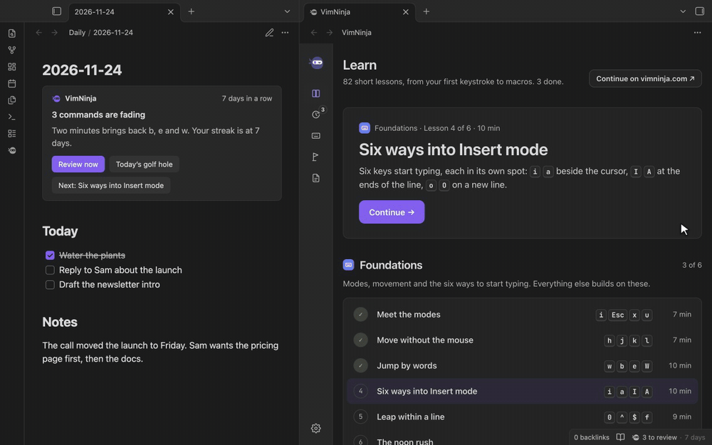
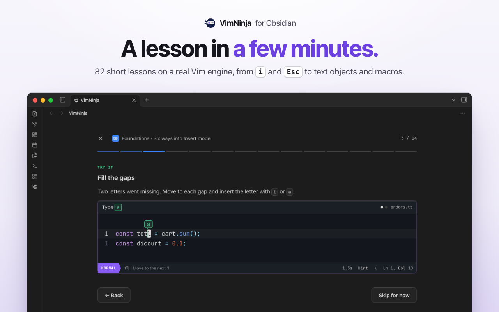
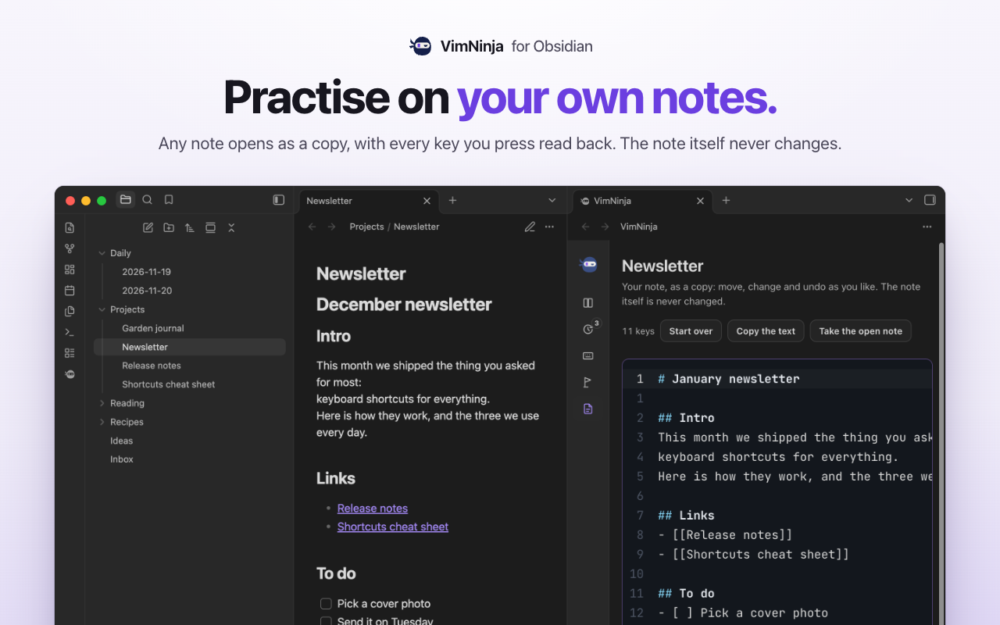
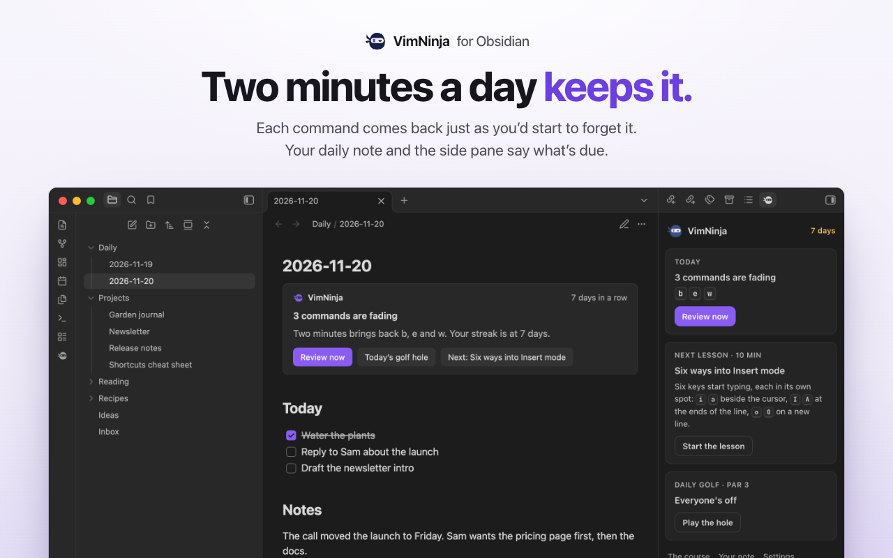
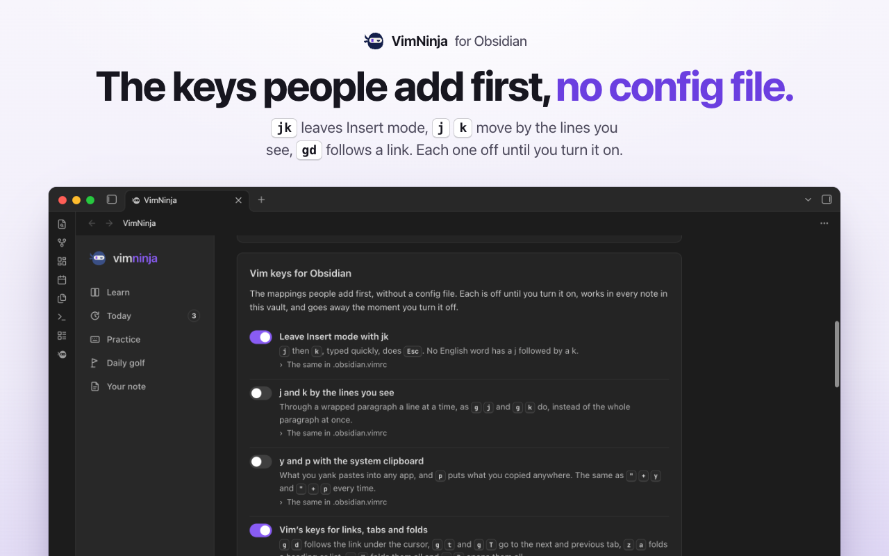
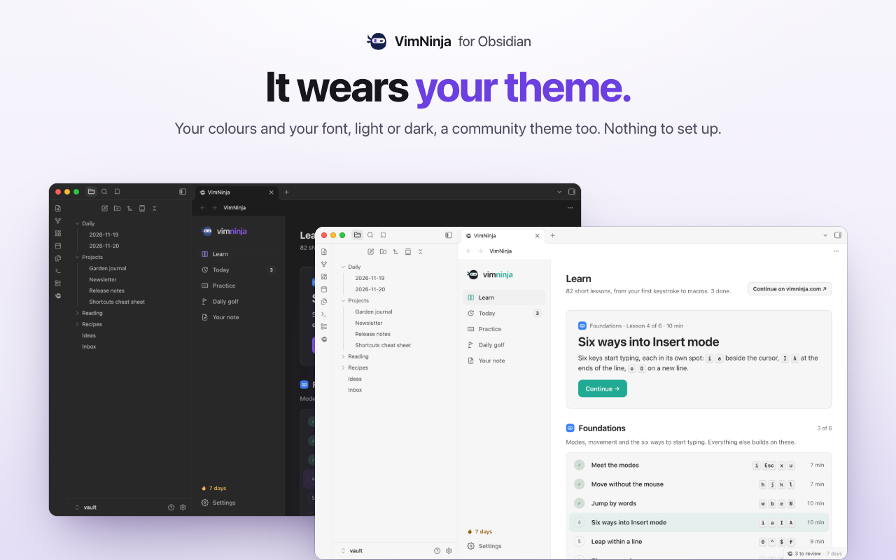

<p align="center">
  
</p>

<h1 align="center">VimNinja for Obsidian</h1>

<p align="center"><b>Learn Vim where you write.</b><br>
Short lessons, a two-minute daily review, Vim golf, and practice on a copy of your own notes,<br>in a tab that looks like the rest of your vault.</p>

<p align="center">
  
  
  
</p>

<p align="center">
  <a href="https://www.vimninja.com/obsidian">vimninja.com/obsidian</a> ·
  <a href="#install">Install</a> ·
  <a href="#vim-keys-for-obsidian">Vim keys for Obsidian</a> ·
  <a href="#privacy-network-accounts-and-payments">Privacy</a>
</p>

---

You turned on Vim key bindings in Obsidian. Then the cursor became a block, `i` started typing, `Esc` stopped, and that was most of it. VimNinja is the rest: the motions, text objects, counts, registers and macros that make editing a note faster than reaching for the mouse, learned a few minutes at a time, on a real Vim engine, without leaving your vault.

## What you get

### A course in a tab

82 short lessons, from your first keystroke to macros. Each one shows an idea, plays it on real text, then hands you the keys. Where Obsidian's Vim works differently (wrapped paragraphs, the clipboard, search patterns, the keys Obsidian has its own way of doing), the lesson says so.

<p align="center"></p>

### Practice on your own notes

Run **Practise Vim on this note** from the command palette, the editor's menu or a file's menu, and the note opens as a copy, with every key you press read back. Select a few lines first to practise just those. Change it, undo it, try it again. The note itself never changes.

<p align="center"></p>

### Two minutes a day keeps it

Each command you learn comes back for a short review just as you'd start to forget it. The status bar counts what's due. A `vimninja` code block in your daily note shows the same, with a button to start, and the side pane can keep today at a glance.

<p align="center"></p>

````markdown
```vimninja
```
````

### Vim keys for Obsidian

The mappings people add first, without writing a config file. Each one is off until you turn it on, works in every note in the vault, and comes off the moment you turn it off. Each shows the `.obsidian.vimrc` line it stands for, so you learn it rather than hide it.

| Turn on | And you get |
|---|---|
| **Leave Insert mode with jk** | `j` then `k`, typed quickly, does `Esc` |
| **j and k by the lines you see** | through a wrapped paragraph a line at a time, as `gj` and `gk` do |
| **y and p with the system clipboard** | a yank pastes into any app; `p` puts what you copied anywhere |
| **Vim's keys for links, tabs and folds** | `gd` follows the link under the cursor, `gt` `gT` change tabs, `za` `zM` `zR` fold |

<p align="center"></p>

### It wears your theme

Your colours, your font, light or dark, a community theme too. The code editor keeps its own colours, as a code block does.

<p align="center"></p>

### And

- **Daily golf:** one Vim puzzle a day. Edit the text into the target in as few keystrokes as you can.
- **Practice drills** for every command, generated on real text.
- **Reminders** while Obsidian is open: at a time you pick, or when you come back. At most one a day, never once today's review is done.
- **A switch for Obsidian's Vim key bindings**, and the things worth knowing about Vim in Obsidian.
- **Optional:** connect a vimninja.com account to sync your practice with the course on the website, and to open the Pro drills here.

## Commands

| Command | |
|---|---|
| **VimNinja: Open** | the tab, where you left it |
| **VimNinja: Show today in the side pane** | streak, what's fading, the next lesson, today's hole |
| **VimNinja: Today's review (the Daily 5)** | two minutes on what's fading |
| **VimNinja: Practise Vim on this note** | the note, or your selection, as a copy |
| **VimNinja: Practise** · **Today's golf hole** · **Next lesson** | straight there |
| **VimNinja: Turn Vim key bindings on or off in notes** | Obsidian's own setting, one command away |
| **VimNinja: Connect your account** | optional sync with vimninja.com |

No default hotkeys: give any of them one in **Settings › Hotkeys**. Every setting turns up in Obsidian's settings search.

## Install

Desktop only (macOS, Windows, Linux), Obsidian 1.13 or later. The course is played on a physical keyboard.

**With BRAT** (the easiest way today, and it keeps VimNinja up to date)

1. In Obsidian, open **Settings › Community plugins › Browse**, install **BRAT** and enable it.
2. Open the command palette (`Ctrl/Cmd + P`) and run BRAT's **Add a beta plugin for testing** command.
3. Paste `jaipandya/vimninja-obsidian` and choose **Add plugin**. If VimNinja isn't on yet, turn it on in **Settings › Community plugins**.

**By hand**

1. Download `main.js`, `manifest.json` and `styles.css` from the [latest release](https://github.com/jaipandya/vimninja-obsidian/releases/latest).
2. Put the three files in a folder named `vimninja` inside your vault's plugins folder: `<your vault>/.obsidian/plugins/vimninja/`.
   On macOS, Finder hides the `.obsidian` folder: press `Cmd + Shift + .` to see it.
3. In **Settings › Community plugins**, press the reload button next to *Installed plugins*, then turn **VimNinja** on.

**From Obsidian's plugin browser** (once VimNinja is listed there): **Settings › Community plugins › Browse**, search for **VimNinja**, then Install and Enable.

**Then:** open the command palette and run **VimNinja: Open**.

## Privacy, network, accounts and payments

- **Nothing leaves Obsidian unless you connect an account.** Lessons, review, practice, golf and reminders all run on your computer. No telemetry, no ads, no tracking.
- **Where it keeps things:** your course progress in Obsidian's app storage on this computer; the plugin's own state for each vault in Obsidian's per-vault storage. Nothing is written into your notes or your vault's files except the plugin's own settings (`data.json`: status bar, colours, notifications, which Vim keys are on).
- **Network use, only if you connect a vimninja.com account** (optional, from VimNinja's Settings): it talks to `https://www.vimninja.com/api/ext/v1/` to connect (a one-time code you approve on vimninja.com, signed in there), to sync your practice results, reviews and plan with your account, and to send finished practice runs to be checked. The key it receives is kept in Obsidian's secret storage, never in the vault, and goes only to that address. Disconnect any time, in VimNinja's Settings or on your account page.
- **Links** to vimninja.com (the full lessons, the guides, Pro) open in your browser, tagged `utm_source=obsidian`.
- **Accounts and payments:** the plugin is free and needs no account: the free lessons, the daily review, golf, Your note and the Vim keys are all there without one. **Full access needs both an account and a payment:** VimNinja Pro, bought on vimninja.com, opens the rest of the course and every drill there, and with a Pro account connected, the Pro drills open in the plugin too.
- **The clipboard** is written only when you press **Copy the text** in Your note, or when you turn on **y and p with the system clipboard**.
- **Closed source:** this repository holds the built plugin, not its source. VimNinja's lessons and Vim engine are its own work.
- **Privacy policy:** [vimninja.com/privacy](https://www.vimninja.com/privacy) says what a connected account stores and how it's handled.

## Support

Questions, a bug, an idea: [vimninja.com/feedback](https://www.vimninja.com/feedback). We read everything.

---

<p align="center"><sub>© 2026 Mutables. VimNinja for Obsidian is free to use; see <a href="LICENSE">LICENSE</a>.</sub></p>
